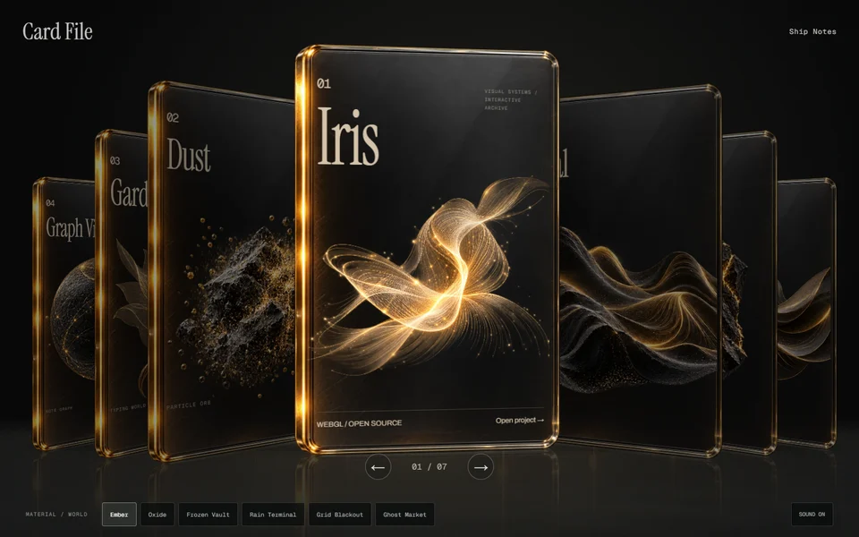
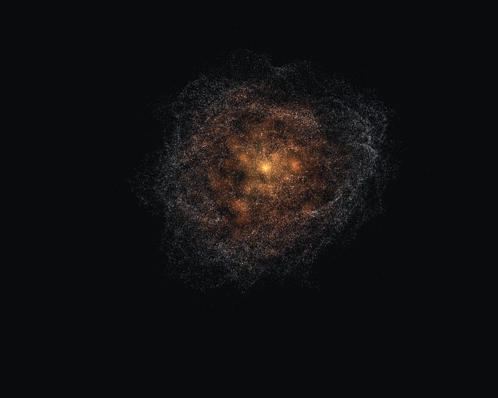
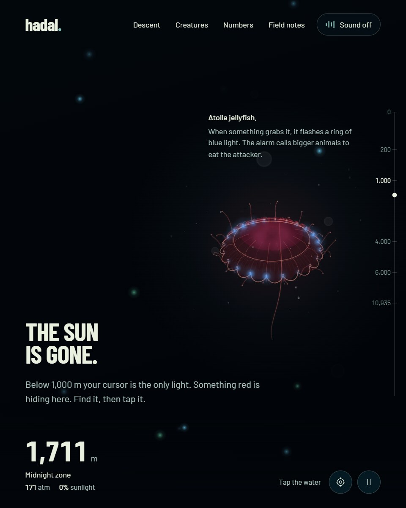
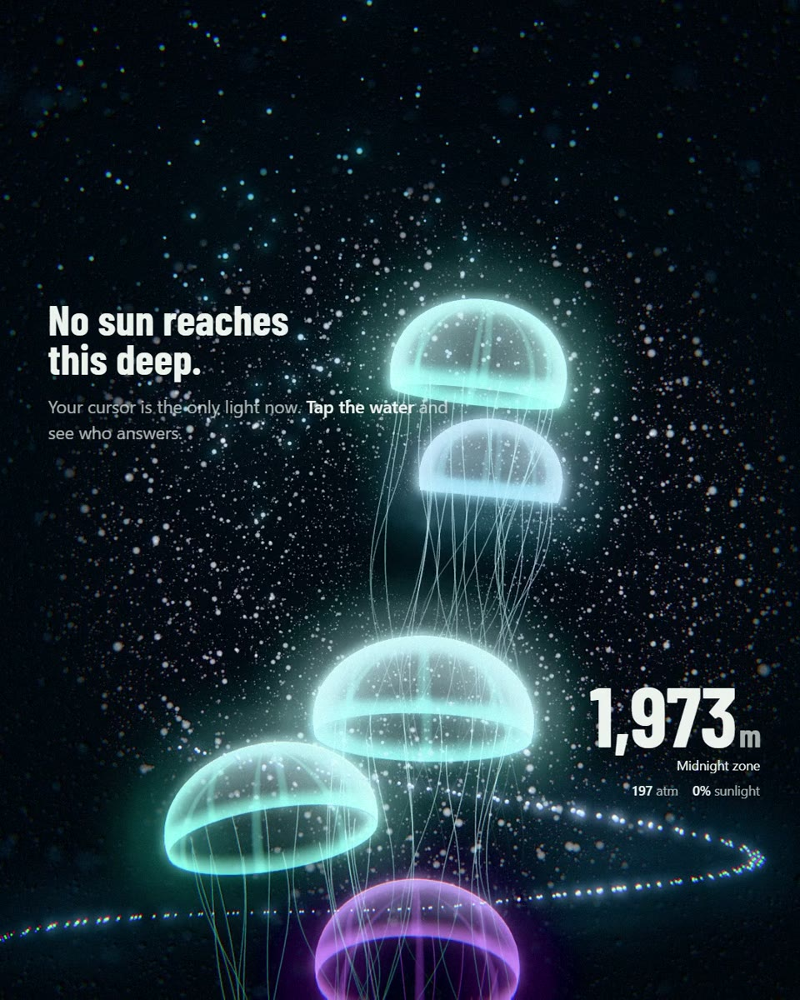
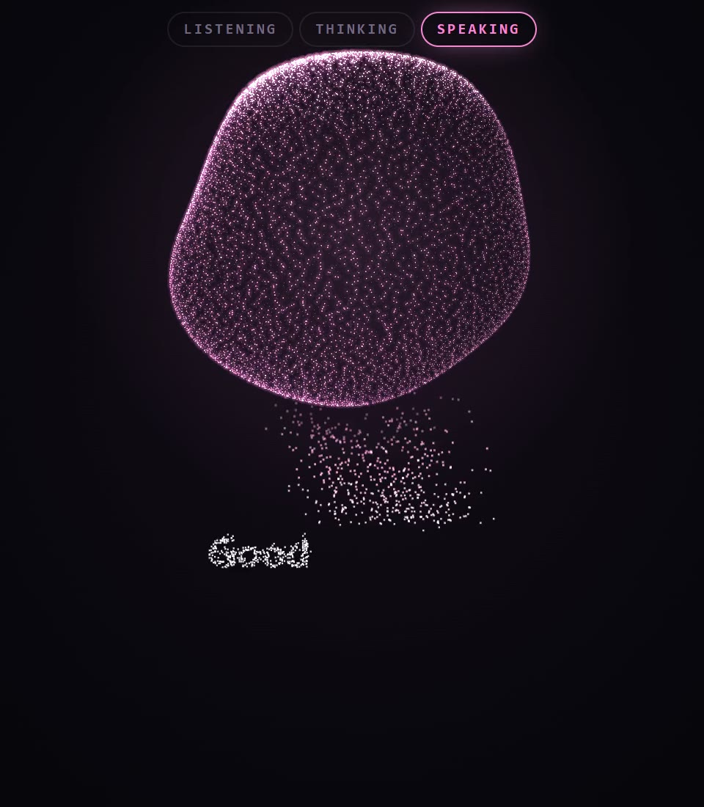
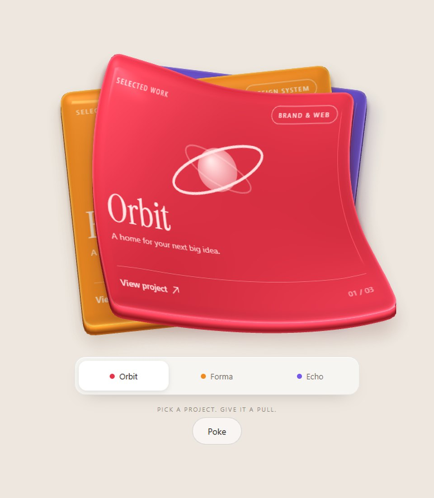
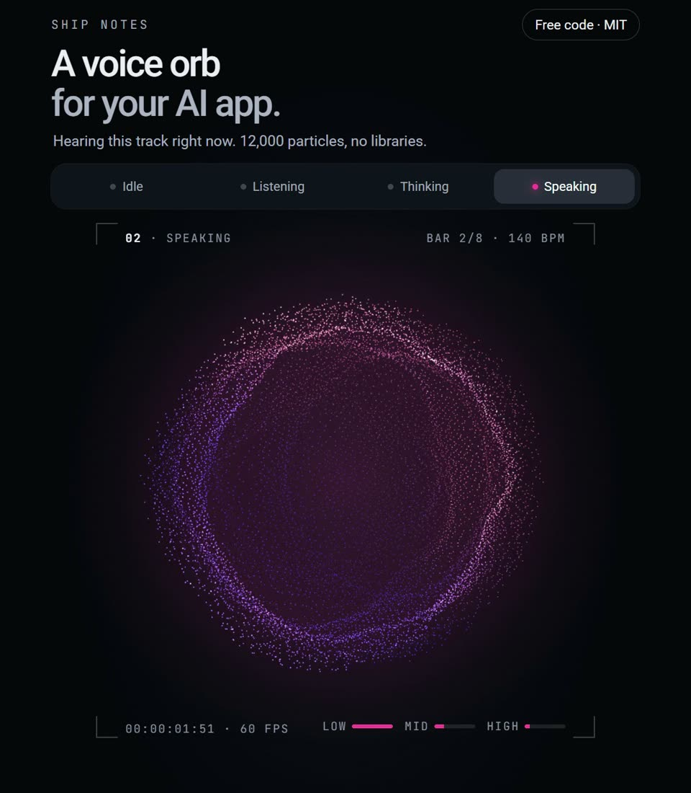
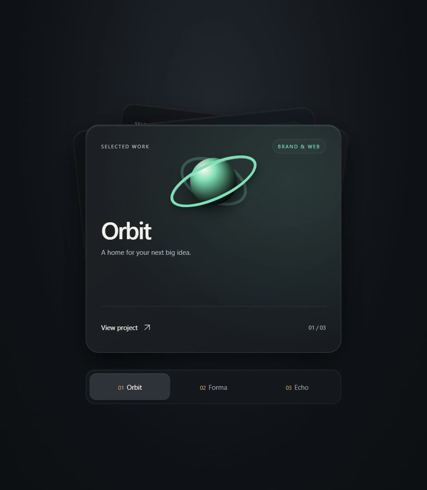
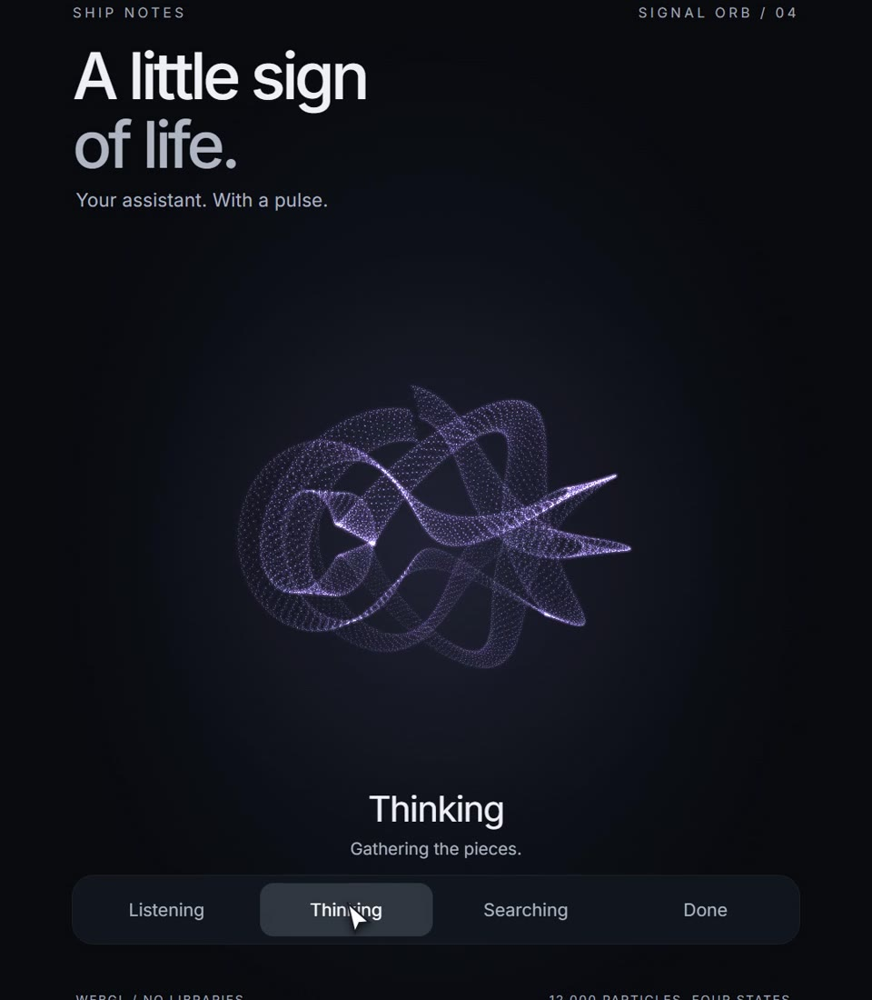
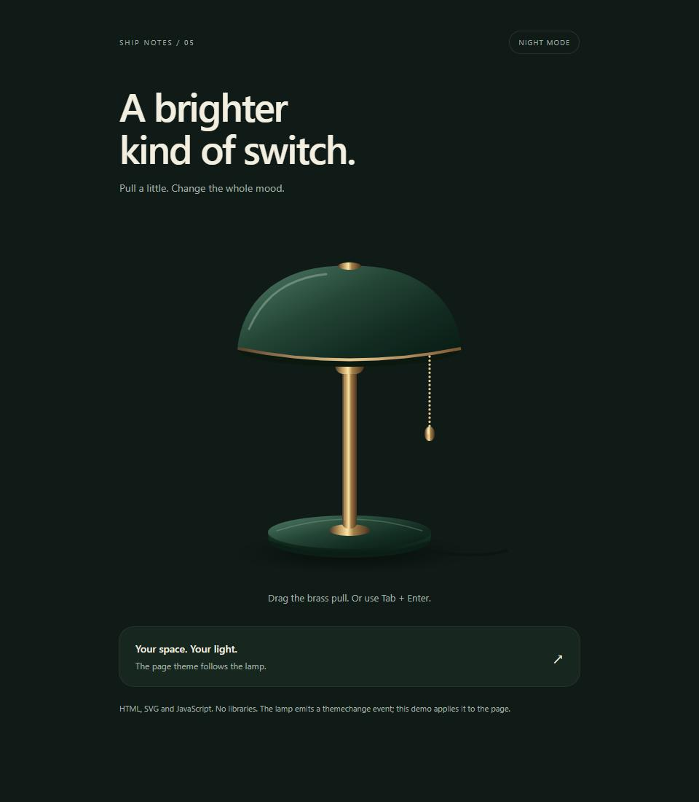

# Ship Notes components

Small interfaces with moving parts, built for [Ship Notes](https://www.instagram.com/shipnotesai/). New components are added as their videos come out.

Want one built for your product? [DM me on Instagram](https://www.instagram.com/shipnotesai/).

## Card File

A shelf for your projects that you can flip through. Swipe hard and it runs through every card, swipe gently and one card steps forward with its picture alive. Six worlds: gold glass, red paper, ice, wet neon, a power console and a night market. Put your own screenshots on the cards; a card without one gets its own drawing of light.

**[Try it live](https://aqualang89.github.io/shipnotes-components/components/card-file/demo.html)**, works on a phone too. Plain HTML, CSS and JS with WebGL for the moving pictures, no libraries. Setup, card fields and events in the [Card File notes](components/card-file/README.md).

## Dust Orb

A cloud of moving dust with light inside. In v2, the folds reach toward your cursor and the inner light follows a moment later. Drag to turn it, tap for a pulse, or connect its five states to your assistant. Free under MIT.

**[Try Dust v2](https://aqualang89.github.io/shipnotes-components/components/dust-orb/v2/)**. Bundled Three.js, optional Air + glass sound, automatic particle density and a Canvas fallback. [Code and setup](components/dust-orb/README.md). [Original v1](https://aqualang89.github.io/shipnotes-components/components/dust-orb/demo.html).

## Iris

A living light orb for a voice assistant: thin membranes and 960 light fibres around a dark pupil. It rests, turns toward you when it listens, sends light through its fibres when it thinks, and pulses with the real loudness of the voice when it speaks. Two palettes, its own air-and-glass sound, microphone input that never leaves the browser.

**[Try it live](https://aqualang89.github.io/shipnotes-components/components/iris/demo.html)**, works on a phone too. Three.js and WebGL 2, own shaders. Five calls drive it from your app; details in the [Iris notes](components/iris/README.md).

## Secret Garden

Type on dark glass and a winter garden grows around your words: frozen leaves, rowan berries, snow settling on the letters. Space cracks the ice, Backspace melts a letter, Enter shatters it. Four ice colours, four fonts, and your own sounds through events.

**[Try it live](https://aqualang89.github.io/shipnotes-components/components/secret-garden/demo.html)**, works on a phone too. Canvas 2D, no libraries. Copy three files and the fonts folder; options and API in the [Secret Garden notes](components/secret-garden/README.md).

## Graph View

An Obsidian-style graph of linked notes for your own site. Notes bloom out of one point and settle into colored clusters; drag any note and the whole web follows. Same forces as Obsidian's graph engine, physics in a Web Worker, code written from scratch.

**[Try it live](https://aqualang89.github.io/shipnotes-components/components/graph-view/demo.html)**, works on a phone too. One JavaScript file, no libraries. Feed it your own notes as JSON; details in the [Graph View notes](components/graph-view/README.md).

## CONTACT

Four controls with a little weight: a switch that starts moving under your finger, a checkbox that gives before the mark appears, a travelling segmented choice, and a range slider that follows your hand. Try three spring profiles and change the accent color in the live bench.

**[Try it live](https://aqualang89.github.io/shipnotes-components/components/contact-lab/demo.html)**. HTML, CSS, and JavaScript with no runtime dependencies. Copy the control files; the demo and usage notes are in the [CONTACT folder](components/contact-lab/README.md).

## Glyph Void

A word left empty inside a field of tiny moving marks. Drag through them and they bend away from your cursor, then settle back. Type your own word to change the opening.

**[Try it live](https://aqualang89.github.io/shipnotes-components/components/glyph-void/demo.html)**. Canvas 2D, no runtime dependencies. Copy the source and font files together; usage is in the [Glyph Void notes](components/glyph-void/README.md).

## AI Face Flow

A face for your voice assistant. While your AI is quiet it's a stream of 180,000 particles. When it starts a reply, the stream flows into a face that talks, turns and looks at you, then dissolves when the reply ends. Hook it to your own TTS: `beginResponse()`, `setLevel()`, `endResponse()`.

**[Try it live](https://aqualang89.github.io/shipnotes-components/components/face-flow/?mode=dialogue)**, sound on. API in the [Face Flow notes](components/face-flow/README.md). Three.js in the folder, no build step, about 8 MB of particle data.

## FOLD (motion)

Six states an AI goes through, played by one folded metal object: idle, listening, thinking, searching, calling a tool, answering. 18.75 seconds on a 128 BPM grid, and the music is generated by code too. Pick a state yourself or play the whole reel.

**[Play it live](https://aqualang89.github.io/shipnotes-components/motion/fold/)**, sound on. API and how the score is made in the [notes](motion/fold/README.md). One page, Three.js, no build step. `fold.setState('thinking')` drives it from your app.

## Hadal: the expedition (a world)

A made-up expedition to the bottom of the Mariana Trench. Red goes first, even the buttons lose it. Below 1,000 m your cursor is the only light: find the red jellyfish, tap it and see what answers its alarm. A beaked whale lit by plankton, an anglerfish, the last fish at 8,336 m, a lander on the floor at 10,935 m.

**[Dive in live](https://aqualang89.github.io/shipnotes-components/worlds/hadal-expedition/)**, sound on. How it works in the [expedition notes](worlds/hadal-expedition/README.md). No libraries, no images: every animal is lines on one canvas, every sound synthesized in the browser.

## Hadal (a world)

Scroll to the bottom of the ocean, 10,935 m down. The water takes the colors the way real water does, a red can turns black by 20 m, and below 1,000 m your cursor is the only light. Tap the water and the jellyfish flash back. Everest is drawn to scale at the bottom.

**[Dive in live](https://aqualang89.github.io/shipnotes-components/worlds/hadal/)**, sound on. How it works in the [Hadal notes](worlds/hadal/README.md). One index.html, Three.js in the folder, every sound synthesized in the browser.

## Speaking Orb

A face for your voice assistant. The orb talks: it swells with the voice, and every word flies out of it as particles and lands as a live caption. Listening, thinking, searching, speaking and done. One line makes it speak with the browser's own voice, or plug in your TTS audio and it follows the real sound.

**[Try it live](https://aqualang89.github.io/shipnotes-components/components/speaking-orb/demo.html)**. Tap a line and it speaks. Full usage in the [Speaking Orb instructions](components/speaking-orb/README.md). One JavaScript file, no libraries, no keys, nothing leaves the page.

## Jelly Stack

Project Stack, but the three cards are jelly. Pull a corner and it stretches, flick it and it whips, tap the card behind and it hops out and splats. Each card is 81 points on springs, and the text bends with the surface.

**[Try it live](https://aqualang89.github.io/shipnotes-components/components/jelly-stack/demo.html)**. Full usage in the [Jelly Stack instructions](components/jelly-stack/README.md). One JavaScript file, no libraries, WebGL with a plain CSS fallback.

## Voice Orb

A voice orb for an AI app: 12,000 particles on WebGL that react to live sound from a mic or anything playing on the page. Bass moves the whole sphere, and the highs throw sparks off the edge. Four states: idle, listening, thinking and speaking.

**[Try it live](https://aqualang89.github.io/shipnotes-components/components/voice-orb/demo.html)**. Tap Play beat, or Talk to it for the mic. Full usage in the [Voice Orb instructions](components/voice-orb/README.md). One JavaScript file, no libraries, and the audio never leaves your browser.

## Project Stack

Three portfolio cards in a stack. Pick a tab and the next card comes forward. Give a project an `accent` color and its card follows it.

**[Try it live](https://aqualang89.github.io/shipnotes-components/components/project-stack/demo.html)**. Full usage in the [Project Stack instructions](components/project-stack/README.md). One JavaScript file, no libraries.

## Signal Orb

A status light for an AI app: listening, thinking, searching and done, drawn with 12,000 particles on WebGL. Your app sets the state; the orb rebuilds into the new shape.

**[Try it live](https://aqualang89.github.io/shipnotes-components/components/signal-orb/demo.html)**. Full usage in the [Signal Orb instructions](components/signal-orb/README.md). One JavaScript file, no libraries. It uses fewer particles on phones and cuts the count further if frames run slow.

## Pull Lamp

A desk lamp that switches the page between light and dark themes. Pull the brass cord, tap it, or use the keyboard.

**[Try it live](https://aqualang89.github.io/shipnotes-components/components/pull-lamp/demo.html)**, works on a phone too.

### Download and try

1. [Download the ZIP](https://github.com/aqualang89/shipnotes-components/archive/refs/heads/main.zip), or use **Code > Download ZIP** above.
2. Extract the ZIP to a folder on your computer.
3. Open `components/pull-lamp/demo.html` in your browser. Keep `pull-lamp.js` beside it.

No account, package install or build step. The demo works locally without a server. GitHub displays the source; opening the HTML file after extraction runs the demo.

### Add it to your site

Follow the [Pull Lamp instructions](components/pull-lamp/README.md) for a complete HTML example. Copy one JavaScript file and connect its `themechange` event to your page's colors. The SVG illustration is included in the component. No runtime libraries or image downloads.

Mouse, touch, keyboard and reduced motion are supported. Tested in Chromium on desktop and at a 390px mobile viewport. Safari, Firefox and physical phones have not been tested in this release check.

## Follow the builds

[Ship Notes on Instagram](https://www.instagram.com/shipnotesai/). Follow along for the next component and its source. Need a custom one for your product? DM me there.

## License

The code is [MIT licensed](LICENSE). Use it in personal or commercial projects, modify it, and keep the license notice when redistributing it.
