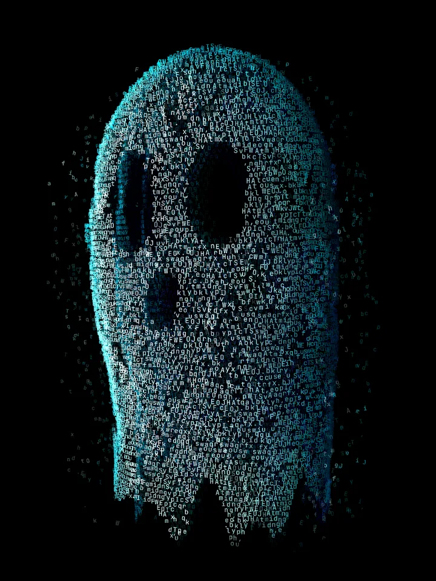

# ASCII Ghost

A visitor made from the text on your page. Add the script and a tag, then leave the page idle for four seconds:

```html
<script src="https://cdn.jsdelivr.net/gh/aqualang89/shipnotes-components@main/components/ascii-ghost/ascii-ghost.js" defer></script>
<ascii-ghost></ascii-ghost>
```

Or [download ascii-ghost.js](ascii-ghost.js) and host it yourself with `src="ascii-ghost.js"`.



**[Try it live](https://aqualang89.github.io/shipnotes-components/components/ascii-ghost/demo.html)** · [the year-round 404 page](https://aqualang89.github.io/shipnotes-components/components/ascii-ghost/404.html)

The ghost uses visible text from the first `main`, otherwise the first `article`, otherwise `body`. Click or tap it to send the letters home. Escape restores the page immediately. No setup JavaScript, framework or font download is required; the component uses a system monospace font when the demo's local font is absent.

## Attributes

| Attribute | Default | Purpose |
|---|---|---|
| `target` | `main`, then `article`, then `body` | CSS selector for the source text container |
| `idle` | `4000` | Idle time in milliseconds before one automatic appearance per connection; `-1` disables it |
| `max-letters` | `600` | Maximum borrowed source characters, limited to 24-1200 |
| `until` | None | Exclusive end date, `YYYY-MM-DD`, at midnight in the visitor's local time |
| `once` | Off | Show once per browser origin, saved in `localStorage` |
| `trigger` | None | `boo` summons the ghost when someone types b-o-o outside input fields |

For Halloween, show it once and let it retire on November 1:

```html
<ascii-ghost once until="2026-11-01"></ascii-ghost>
```

From November 1 onward this tag installs no listeners or observers, schedules no timer and creates no renderer. The date is local to the visitor, not UTC. Invalid dates are ignored. `once` records a successful appearance using `ascii-ghost:seen:v1` on the current origin. If storage access is denied, the ghost still works; a later page visit can show it again.

For a keyboard Easter egg, turn off the idle appearance:

```html
<ascii-ghost idle="-1" trigger="boo"></ascii-ghost>
```

Typing in an input, textarea, select or editable content does not trigger it. Keyboard shortcuts and composing text are ignored.

## Pin a version

For production, pin the release and check the file with its SHA-384 integrity value:

```html
<script src="https://cdn.jsdelivr.net/gh/aqualang89/shipnotes-components@ascii-ghost-v1.0.0/components/ascii-ghost/ascii-ghost.js"
        integrity="sha384-YDiCGCPt4UGTo4ySNAC2hDP8dZUobcc9X5VojN1WrIwLV6MVUn0sIZwCuwCW1dog"
        crossorigin="anonymous" defer></script>
<ascii-ghost></ascii-ghost>
```

The hash matches this exact `ascii-ghost.js` file. Any file change needs a new hash. Use an immutable version URL for integrity checks; the file at `@main` can change.

## A 404 that keeps its ghost

[404.html](404.html) includes a complete mobile layout. It borrows letters from the error message and works all year:

```html
<main>
  <p>404</p>
  <h1>This page is gone. Its ghost stayed.</h1>
  <p>Something used to live at this address. A few letters still remember the way home.
     Wait a few seconds, then tap the ghost to send them back.</p>
  <a href="/">Back home</a>
</main>
<script src="ascii-ghost.js" defer></script>
<ascii-ghost></ascii-ghost>
```

Keep enough visible text for the ghost to borrow. Links stay usable and their letters are excluded. Configure your host to serve this document for missing pages with an HTTP 404 status; opening the demo file directly only previews the page.

## Run locally

Serve this folder with any static server, for example:

```sh
npx serve .
```

Open `demo.html` or `404.html` at the address printed by your server. The demo loads its own fonts from `assets/fonts`; the standalone component does not fetch them.

## API

Use JavaScript when you want your own button or a recorded timeline:

```js
const ghost = document.querySelector('ascii-ghost');
await ghost.prepare();
await ghost.summon();
```

| Member | Purpose |
|---|---|
| `prepare()` | Wait for page fonts and initialize WebGL before an interaction |
| `summon()` | Collect visible source letters and start the ghost |
| `boo()` | Start the surprise and return sequence |
| `banish()` | Restore text immediately and stop rendering |
| `renderAt(seconds, options)` | Render a deterministic frame for recording |
| `state`, `metrics`, `letterInventory` | Inspect the state, renderer and source characters |

Events are `ghost:summon`, `ghost:boo`, `ghost:home`, `ghost:banish` and `ghost:error`. Use them to connect your own sound effects. The component contains no audio.

For an active recorded ghost without a scheduled BOO:

```js
await ghost.prepare();
ghost.renderAt(4, { booAt: Infinity });
```

The recording timeline defaults to BOO at 7.4 seconds. `booAt` changes that time. `returnRate` defaults to `1`; a larger positive number speeds up the return after the first 0.40 seconds of BOO. Rendering and source-letter restoration use the same clock. These recording options do not change the normal interactive timeline.

## Text and accessibility

The component measures visible characters with `Range` and hides borrowed letters with the CSS Custom Highlight API. It preserves text content and line geometry without wrapping every letter in a span. Three nested shells repeat the source glyphs to build the volume, then the borrowed characters return to their measured positions.

Inputs, editable content, links, buttons and code blocks are excluded. Add `data-ghost-ignore` to any other container that should stay untouched. Source edits and disconnecting the component restore the text. A hidden tab pauses the animation. Reduced motion or unsupported graphics shows a small static visitor without borrowing letters.

## Browsers

Needs WebGL 2 and the CSS Custom Highlight API: current Chrome, Edge and Safari 17.2+, Firefox 140+. Older browsers get the quiet static visitor. Tested in Chromium on desktop and at a 390px mobile viewport; physical iPhones and Firefox have not been tested in this release.

## License

MIT. Font licenses are included beside the demo fonts.
